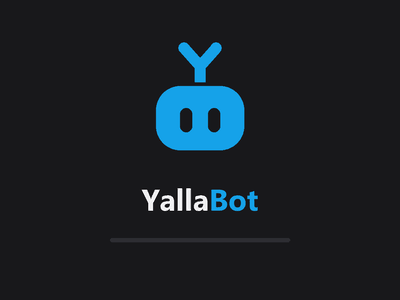

<picture>
  <source media="(prefers-color-scheme: dark)" srcset="yallabot-horizontal-dark.svg" />
  
</picture>

### بوت عربي لقناتك على Twitch

يرد على المشاهدين، يشغّل الأغاني، يحمي الشات، ويعرف مين أكثر واحد متفاعل.

---

## 👋 تعرّف على Yallo

Yallo هو البوت نفسه، روبوت صغير بهوائي على شكل حرف Y. تقدر تختار شكله ومزاجه وكلامه، ويرافقك في لوحة التحكم.

---

## ✨ ماذا يفعل البوت؟

### 💬 أوامر لقناتك
- أنشئ أوامرك الخاصة بأي رد تريده، من الموقع أو من الشات مباشرة
- **33 أمراً جاهزاً** تضيفها بضغطة: `!رايي` `!حب` `!ذكاء` `!حظ` `!نرد` `!8ball` `!اختار` `!احسب` `!حجر` `!نكتة` `!حكمة` وغيرها
- ردود ذكية تعرف اسم المشاهد، اللعبة الحالية، مدة البث، عدد المشاهدين، وغيرها
- ردود عشوائية مضحكة، تماماً مثل Nightbot وأكثر

### 📊 من الأفضل في قناتك؟
- `!level` مستوى المشاهد ونقاطه من تفاعله ومشاهدته
- `!streak` كم بثاً متتالياً حضر (مثل ستريك سناب)
- `!topchat` أكثر 5 متفاعلين في الشات
- `!followage` منذ متى يتابع القناة
- `!accountage` عمر حسابه على Twitch
- لوحة متصدرين للشات والستريك ووقت المشاهدة

### 🎵 طلبات الأغاني
- المشاهد يكتب `!song` واسم الأغنية أو رابطها من يوتيوب
- قائمة انتظار تتحكم بها: ترتيب، تخطي، وصوت
- `!currentsong` `!nextsong` `!skip` `!vol`

### 🛡️ حماية الشات
- فلتر للكلمات الممنوعة يحذف الرسالة فوراً
- تحديد البوتات الأخرى حتى لا تُحسب في الإحصائيات

### 📺 إدارة البث من الشات
- `!title` و `!game` لتغيير عنوان البث واللعبة
- `!addcom` `!editcom` `!delcom` لإدارة الأوامر بدون فتح الموقع

### ⏰ رسائل تلقائية
- رسائل يرسلها البوت كل فترة، مثل روابط السوشال أو التذكيرات

### 🔔 ابقَ على اطلاع
- المتابعون الجدد، **ومن ألغى المتابعة ومتى**
- الاشتراكات والإهداءات وكل نشاط القناة

### 🌍 عربي وإنجليزي
- الموقع والبوت يتكلمان بلغتك

---

## 🖥️ تطبيق Windows

- يعمل في الخلفية بجانب الساعة، ويبدأ مع Windows
- **الشات فوق الألعاب** لترى رسائل المشاهدين أثناء اللعب
- يتحدّث تلقائياً دون أن تفعل أي شيء

---

## 📜 صفحة أوامر لمشاهديك

كل قناة لها صفحة عامة فيها كل أوامرها، يفتحها المشاهد بكتابة `!commands` في الشات.

---

**YallaBot** · صُنع بحب للمجتمع العربي على Twitch 💙

